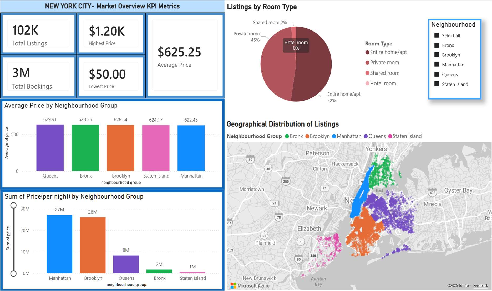
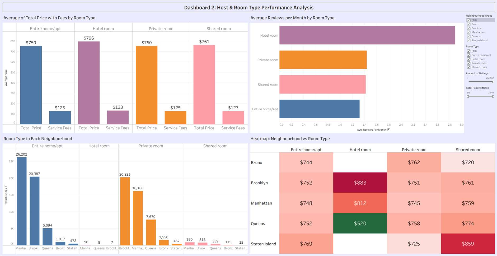

# NYC Airbnb Market: Power BI and Tableau Dashboards

> 🎓 Completed as part of the **Higher Diploma in Science in Data Analytics (QQI Level 8)** at **Dublin Business School**, 2025–2026 (graduated with First Class Honours).
*Module: Platforms for Data Analytics (CA1).*

## Problem
Turn a large Airbnb listings dataset (100K+ rows) into visual stories about pricing, location, room type and guest activity, and compare building the same kind of analysis in **Power BI** and in **Tableau**.

## Data
The public **Airbnb Open Data** (New York City) from Kaggle. It isn't included here because of its size (about 17 MB as Excel). Download it from Kaggle by searching "Airbnb Open Data" and save it as `data/Airbnb_Open_Data_clean.xlsx` for the Tableau workbook.

## Tools
Power BI Desktop (Power Query, DAX) · Tableau Desktop · Excel

## Method
- **Cleaning:** removed rows missing key fields (id, price), fixed neighbourhood-group labels, filtered unrealistic values, converted types, added a calculated *Total Price* (price + service fee).
- **Dashboard 1 (Power BI): Market overview.** KPI cards, average and total price by neighbourhood group, room-type mix and a geographic map.
- **Dashboard 2 (Tableau): Room type and host performance.** Total price with fees by room type, reviews per month, room types by neighbourhood and a price heatmap.




## Key insights
- About **102K listings**. Average nightly price is about **$625** (range $50–$1,200).
- Average price is similar across the five boroughs (about $622–$630), but **Manhattan and Brooklyn dominate total volume**.
- **Entire home/apt makes up 52%** of listings and private rooms 45%. Shared (2%) and hotel rooms are rare.

## Files
The Power BI dashboard is shown in the screenshot above. The `.pbix` file is available on request. The Tableau workbook is included.

```
tableau/airbnb_room_type_performance.twb
images/
```

## Author
Jean Ly Kon · [LinkedIn](https://www.linkedin.com/in/jeankly) · [GitHub](https://github.com/jennykonjl)
